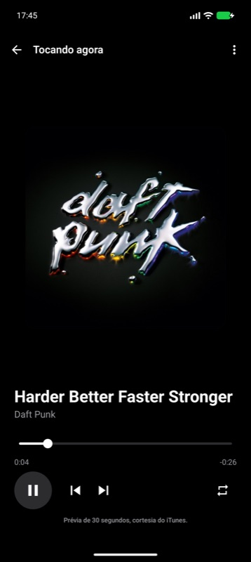
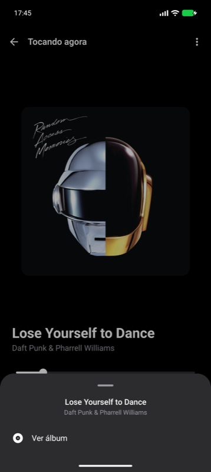
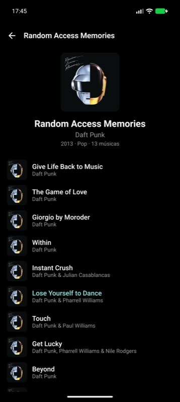
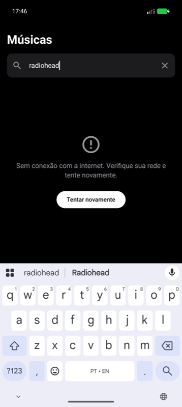

# Tunes

An Android app to search songs in the iTunes catalog, play their previews and browse albums.
Built for the Moises / Music AI Android code challenge.

<p align="center">
  
  
  
  
  
  
</p>

Screenshots taken from the app running on a Pixel 9 Pro emulator (device language pt-BR; the app
ships English and Brazilian Portuguese). The Figma references are in [`docs/design`](docs/design).

## Running the app

Requirements: Android Studio 2026.2 or newer (the project uses AGP 9.4), the Android 37 SDK platform and an
emulator or device on Android 8.0 (API 26) or newer. Gradle runs on JDK 25, pinned in
`gradle/gradle-daemon-jvm.properties` and downloaded automatically on the first build (any JDK 17+ can launch the wrapper).

```bash
./gradlew :app:installDebug          # build and install on the connected device/emulator
./gradlew testDebugUnitTest :core:common:test :core:model:test   # JVM unit tests (all modules)
./gradlew connectedDebugAndroidTest  # Room DAO tests + Compose UI tests (needs a device)
```

Or open the project in Android Studio and run the `app` configuration. No API keys are needed: the
app uses the public [iTunes Search API](https://developer.apple.com/library/archive/documentation/AudioVideo/Conceptual/iTuneSearchAPI/).

## What is implemented

| Requirement | Where |
| --- | --- |
| Splash, Songs (home), Player, More-options sheet, Album | `app/.../splash`, `feature:songs`, `feature:player`, `core:designsystem` (`OptionsBottomSheet`), `feature:album` |
| Kotlin, Coroutines/Flow, Jetpack Compose, MVVM | everywhere; one `ViewModel` per screen exposing a `StateFlow` |
| API pagination | Paging 3 with a `RemoteMediator` (`core:data/paging`) – see [Pagination](#pagination-on-an-api-without-offset) |
| Network abstraction layer | `SongsRemoteDataSource` interface in `core:network`; the iTunes implementation is `internal` and bound in DI |
| Cache / offline-first, recently played on home | Room is the single source of truth (`core:database`); the home shows the recently played list from the database |
| Tests | 67 JVM unit tests, 8 Room DAO instrumented tests, 17 Compose UI tests – see [Testing](#testing) |
| Error / empty / loading states | every screen; cached data stays visible with an "offline" banner when a refresh fails |
| Pull to refresh | search results and album |
| Forward / backward, timeline, drag-to-seek, repeat | `feature:player` + `core:player` |
| Background playback, media notification / lock-screen controls, headset buttons | `core:player` (`PlaybackService`, Media3 `MediaSession`) |
| Accessibility | content descriptions on every control, merged semantics on list rows, 48dp+ touch targets, slider state announced as "0:12 of 0:30" |

## Architecture

```
                 ┌──────────────┐
                 │     app      │  navigation graph, splash, Hilt root, playback history tracker
                 └──────┬───────┘
      ┌─────────────────┼─────────────────┐
┌─────┴──────┐  ┌───────┴──────┐  ┌───────┴──────┐
│feature:songs│  │feature:player│  │feature:album │   screens + ViewModels (MVVM)
└─────┬──────┘  └───────┬──────┘  └───────┬──────┘
      └────────┬────────┴────────┬────────┘
        ┌──────┴──────┐   ┌──────┴──────┐   ┌──────────────────┐
        │  core:data  │   │ core:player │   │ core:designsystem │  theme + reusable Compose components
        └──────┬──────┘   └─────────────┘   └──────────────────┘
       ┌───────┴────────┐
┌──────┴──────┐  ┌──────┴───────┐
│core:network │  │core:database │   iTunes Retrofit impl   |   Room entities + DAOs
└──────┬──────┘  └──────┬───────┘
       └───────┬────────┘
        ┌──────┴──────┐  ┌─────────────┐
        │ core:model  │  │ core:common │   pure Kotlin: domain models, errors, clock
        └─────────────┘  └─────────────┘
```

Not drawn: `app` also depends on `core:network` and `core:database` so Hilt can see their modules, and
`core:testing` (fakes, test data, paging helpers) is shared by every module's tests.

* **Unidirectional data flow.** Every screen is a stateless `*Screen` composable fed by a `*Route`
  that collects a `StateFlow` from its ViewModel. Screens never touch repositories or the player;
  ViewModels never touch Android UI types. This keeps screens previewable and testable with plain state objects.
* **Offline-first.** The UI always renders what is in Room. Network calls only *write* to Room
  (`SearchRemoteMediator`, `AlbumRepository.refreshAlbum`). When the network fails the cached data
  stays on screen and a banner explains that it may be stale. Cached searches are considered fresh
  for 15 minutes and are not re-fetched during that window; pull-to-refresh forces it.
* **Replaceable network layer.** `core:data` depends only on the `SongsRemoteDataSource` interface
  and on domain models. Everything iTunes-specific (Retrofit service, DTOs, mappers, the pagination
  workaround) is `internal` to `core:network`. Swapping the catalog API means writing one new class
  and changing one `@Binds` line in `NetworkModule`.
* **Replaceable player.** The same applies to playback: features depend on `PlaybackController`;
  the Media3 implementation is internal to `core:player`. Playback state is a `StateFlow`
  owned by an app-scoped singleton, so it survives navigation and both the player and the lists can observe it.
* **Convention plugins** (`build-logic/`) centralise the Android/Compose/Hilt Gradle configuration so
  each module's build file only declares its dependencies.
* **SOLID in practice.** Small interfaces with a single reason to change (`SongsRepository`,
  `RecentlyPlayedRepository`, `AlbumRepository`, `SearchLocalDataSource`, `TransactionRunner`,
  `TimeProvider`), implementations injected through Hilt, and features that
  depend on abstractions rather than on each other.

### Pagination on an API without `offset`

The challenge asks for API pagination, but the iTunes Search API only supports `limit` (1–200) and
silently ignores `offset` (verified: `offset=25` returns the same results as `offset=0`).

The app still implements real, incremental pagination with Paging 3:

1. `SearchRemoteMediator` asks the remote data source for *page n*.
2. `ItunesSongsRemoteDataSource` translates that into `limit = (n + 1) * pageSize` and drops the
   items already delivered by earlier pages (`ItunesPagination`). The 200-result cap of the API
   naturally marks the end of pagination.
3. The new items are appended to Room (`search_results` keeps the API order); the Room `PagingSource`
   is what the list actually renders, so scrolling is instant and works offline.

Because result ordering between two calls is not guaranteed to be identical, rows are keyed by song
id and duplicates are ignored on insert. If the API ever starts honouring `offset`, only
`ItunesPagination` changes – nothing above the network layer knows about this workaround.

### Playback

Songs are played from the 30-second preview URLs the API provides (the only audio available), with
`"courtesy of iTunes"` attribution on the player as the API terms request. Forward/backward move
through the list the song was started from (search results, recently played or album). Songs without
a preview are kept in the lists but the player explains that no preview is available.

The engine (ExoPlayer) lives in `PlaybackService`, a Media3 `MediaSessionService` declared with
`foregroundServiceType="mediaPlayback"`. The app never touches ExoPlayer directly:
`SessionPlaybackController` connects a `MediaController` to the service and maps its `Player` state to
`PlaybackState`. Because the controller is itself a `Player`, the mapping is the same as it would be
against ExoPlayer, while the system gets a real media session. That gives, with no feature code involved:

* playback that continues in the background and when the screen is locked (foreground service);
* the system media notification / lock-screen card with artwork, play/pause, previous, next and seek
  (`docs/screenshots/notification.jpg`), driven by the same queue the in-app player shows;
* headset and Bluetooth buttons, Assistant and other controllers; a "next" from the notification is
  reflected instantly in the app, since both observe the same session.

The controller connects as soon as the app starts. Commands issued before the connection is ready are
queued in order and replayed on connection, with the UI state updated optimistically in the meantime.
Swiping the task away keeps the music playing (the activity goes, the process and its state stay) and the
service stops itself when nothing is playing. The app also never depends on in-memory state to know what
the session plays: each item's metadata carries every `Song` field, so a queue the controller did not
start (a session restored by the system or started by another controller) is rebuilt on connection and
shows up in the home highlight, the player and the history.

## Testing

| Layer | Kind | What is covered |
| --- | --- | --- |
| `core:network` | JVM + MockWebServer | request parameters, DTO → model mapping, filtering of non-song results, pagination slicing, HTTP/IO errors → `TunesException` |
| `core:data` | JVM with fakes | `SearchRemoteMediator` (refresh/append/end/error/TTL), recently played ordering/limit, album refresh + cache replacement, query normalization |
| `core:player` | JVM | queue preparation (unplayable songs, index remapping), derived playback state |
| `feature:*` | JVM with fakes (`core:testing`) | `SongsViewModel` debounce/search/history, `PlayerViewModel`, `AlbumViewModel` state machine (loading, content, not found, error, stale cache, retry) |
| `core:database` | Instrumented | DAO queries: ordering of search results, recently played and album tracks, remote keys, trimming |
| `feature:*` | Compose UI tests | every state of the three screens (lists, empty, loading, error with retry, offline banner, disabled controls) |

Test doubles are hand-written fakes (no mocking framework) so tests exercise real behaviour of the
collaborators' contracts. CI (`.github/workflows/ci.yml`) runs unit tests, lint and assembles the debug APK.

## Trade-offs and next steps

* **Playback runs in a foreground `MediaSessionService`** (background playback, lock-screen and
  notification controls, headset buttons). The default Media3 notification is used as is; a custom
  notification layout or custom commands (e.g. a "repeat" button) would be the next step.
* **The `MediaController` connection is not unit-tested.** It needs a real session (Robolectric or an
  instrumented test). Everything around it is pure and tested: queue preparation (`PlaybackQueue`),
  the engine-to-state mapping (`PlaybackStateReducer`) and the history tracking (`PlaybackHistoryTracker`).
* **Pagination cost.** Because the API ignores `offset`, page *n* re-downloads pages 0..n-1 (the eighth
  page is a 200-item response) and the catalog allows roughly 20 calls per minute, hence the search
  debounce and the 15-minute cache. A backend with real cursors would make the mediator cheaper, not different.
* **"View album" needs a `collectionId`.** Singles and some compilations come without one; those songs
  simply have no "more options" menu rather than a dead action.
* **History keeps 50 songs and the home shows 20.** The surplus is there for a future "see all" without a
  schema change; both numbers are constants next to each other.
* **Dark theme only, matching the design.** Light theme would be a second color scheme in `core:designsystem`.
* **Landscape is functional, not designed.** The player shrinks its artwork and scrolls on short
  viewports; a dedicated two-pane layout was out of scope.
* **Search results are the client-side pagination described above.** A real backend would expose a
  cursor/offset; the mediator is already written for that model.
* **No image pre-fetching / disk cache tuning** beyond Coil's defaults (which include a disk cache).
* **The search field owns its text state** (`rememberSaveable` in `SongsScreen`) and only notifies
  the ViewModel, which keeps the query in `SavedStateHandle`. Driving a `TextField` from a
  `StateFlow` round-trip drops or reorders characters when typing fast (reproduced on the emulator),
  which is why Compose's own guidance keeps text-field state in the UI layer.
* **Single flavour, no feature flags, no analytics** – intentionally lean.
* Possible follow-ups: album pre-population from the song that opened it (instant header), a
  mini-player on the home screen, more locales (en and pt-BR ship today), screenshot tests.
